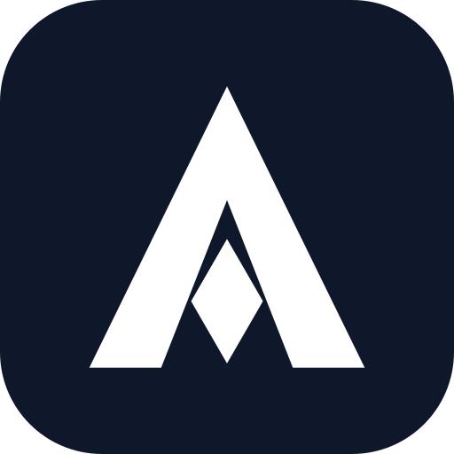

<p align="center">
  
</p>

<h1 align="center">Antigravity MCP Orchestrator</h1>
<p align="center"><strong>Production-Grade Model Context Protocol Server for Google Gemini & Antigravity IDE</strong></p>

<p align="center">
  <a href="https://modelcontextprotocol.io"></a>
  <a href="https://python.org"></a>
  <a href="https://pixi.sh"></a>
  <a href="https://kernel.org"></a>
  <a href="LICENSE"></a>
</p>

A production-grade **Model Context Protocol (MCP)** server specifically engineered for **Google Gemini Connected Apps** (which connects over a public `https://` URL without passwords), local **Google Antigravity IDE**, and other MCP clients.

This server bridges cloud-based Gemini (Gemini Spark / Web / Advanced) directly to your local Linux workstation, allowing Gemini to autonomously explore your codebase, discover 160+ specialized skills, inspect plugins and rules, view conversation transcripts, and execute workspace commands.

---

## ✨ Core Features

- 🌐 **Full Gemini Connected Apps Compatibility**:
  - Implements **RFC 9728** (`/.well-known/oauth-protected-resource/sse`) and **RFC 8414** (`/.well-known/oauth-authorization-server`).
  - Supports **RFC 6749** OAuth 2.0 PKCE / Authorization Code flow with auto-approved tokens.
  - Implements `HEAD /sse` pre-flight health checks required by Google Cloud.
  - Full Server-Sent Events (SSE) and direct streamable HTTP POST support with CORS.
- 🧰 **Zero External Python Dependencies**: Built entirely with Python's standard library (`http.server.ThreadingHTTPServer`, `urllib`, `json`, `subprocess`).
- ⚡ **Pixi & Native Python Support**: Packaged with [`pixi`](https://pixi.sh) for reproducible environments, but runs equally well with vanilla `python3`.
- 📁 **Multi-Workspace Orchestration**:
  - Automatically discovers all your active and known local repositories (`list_known_workspaces`).
  - Dynamically switches active targets on-the-fly (`set_active_workspace`) without restarting the server or tunnel.
- 🧠 **Deep Antigravity IDE Integration**:
  - **160+ Skills**: Search and view global (`~/.gemini/config/skills`), workspace (`.agents/skills`), and plugin skills.
  - **Plugins**: Discover installed bundles (`cursor-team-kit`, `pstack`, `ponytail`) and subagents.
  - **Rules**: Enforce project standards (`GEMINI.md`, `AGENTS.md`, `.agents/rules/*.md`).
  - **Conversations & Brain Artifacts**: Read step-by-step transcripts and inspect generated markdown diffs/plans.
  - **Safe Execution**: Run shell commands with configurable timeouts and current working directory control.

---

## 🚀 Quick Start (Linux)

### 1. Prerequisites

- **Python 3.10+** (standard on modern Linux distributions)
- **Pixi** (recommended):
  ```bash
  curl -fsSL https://pixi.sh/install.sh | bash
  ```
- **Cloudflared** (for creating secure public HTTPS endpoints):
  ```bash
  # Debian / Ubuntu:
  sudo mkdir -p --mode=0755 /etc/apt/keyrings
  curl -fsSL https://pkg.cloudflare.com/cloudflare-main.gpg | sudo tee /etc/apt/keyrings/cloudflare-main.gpg >/dev/null
  echo 'deb [signed-by=/etc/apt/keyrings/cloudflare-main.gpg] https://pkg.cloudflare.com/cloudflared any main' | sudo tee /etc/apt/sources.list.d/cloudflared.list
  sudo apt-get update && sudo apt-get install -y cloudflared

  # Arch Linux:
  sudo pacman -S cloudflared

  # Or download standalone binary:
  curl -L --output cloudflared https://github.com/cloudflare/cloudflared/releases/latest/download/cloudflared-linux-amd64
  chmod +x cloudflared && sudo mv cloudflared /usr/local/bin/
  ```

---

### 2. Installation

Clone this repository to any location on your Linux machine:

```bash
git clone https://github.com/<your-username>/<your-repo-name>.git
cd <your-repo-name>
```

> 💡 **Repository & Directory Name**:  
> You can name your GitHub repository whatever you wish (e.g. `antigravity-mcp-orchestrator`, `gemini-antigravity-bridge`). Your local directory name does not restrict what you call your remote GitHub repository.

---

### 3. Running the Server

#### Option A: Background Daemon (Recommended)
Keeps the server and tunnel running continuously so **Gemini can orchestrate Antigravity IDE even when you close your terminal or step away**:

```bash
# Start background daemon (starts HTTP server on port 8080 + Cloudflare tunnel)
./start_daemon.sh

# View current connection status and public HTTPS URL:
./status.sh

# Stop background daemon:
./stop_daemon.sh
```

#### Option B: Foreground with Pixi
```bash
pixi run tunnel
```

#### Option C: Foreground with Vanilla Python
```bash
# Terminal 1: Start HTTP server
python3 server.py --http 8080

# Terminal 2: Start Cloudflare tunnel
cloudflared tunnel --url http://127.0.0.1:8080
```

---

## 🔗 Connecting to Google Gemini Connected Apps

1. Start your server (via `./start_daemon.sh` or `pixi run tunnel`).
2. Run `./status.sh` or copy the generated HTTPS URL from the terminal:
   ```text
   https://<random-subdomain>.trycloudflare.com/sse
   ```
3. Open **Google Gemini** (Gemini Spark / Web / Advanced) → **Settings** → **Connect to an MCP server** (or **Connected Apps**).
4. Fill in the connection form:
   - **MCP server URL**: `https://<random-subdomain>.trycloudflare.com/sse`
   - **Client ID**: `gemini-client` *(or any identifier)*
   - **Client secret**: `gemini-secret` *(or any string)*
5. Click **Connect**.
6. Google Gemini will perform the OAuth handshake, complete the verification, and display your Antigravity tools!

> ℹ️ **Google's Redirect URI (`oauth-redirect.googleusercontent.com`)**:  
> The redirect URI displayed in Google's UI is handled automatically by the server's OAuth authorization handler. No manual navigation or DNS configuration is needed.

---

## 🤖 Local Antigravity IDE Integration (Stdio)

To also use this MCP server directly inside your local **Antigravity IDE** alongside Gemini, register it in `~/.gemini/config/mcp_config.json`:

```json
{
  "mcpServers": {
    "antigravity-orchestrator": {
      "command": "pixi",
      "args": [
        "run",
        "--manifest-path",
        "/path/to/your/repo/pixi.toml",
        "python3",
        "/path/to/your/repo/server.py",
        "--stdio"
      ],
      "disabled": false
    }
  }
}
```

---

## 🛠️ Complete MCP Toolset (18 Tools)

| Tool Name | Description | Key Arguments |
| :--- | :--- | :--- |
| `get_antigravity_status` | Returns IDE status, active workspace, total skills/plugins/rules counts, and system info. | None |
| `list_known_workspaces` | Discovers and lists all development workspaces on the machine, showing which one is currently active. | None |
| `set_active_workspace` | Dynamically switches the active workspace to another project directory at runtime. | `workspace_path` *(required)* |
| `list_skills` | Discovers skills across all scopes (`all`, `workspace`, `global`, `builtin`, `plugins`). | `scope`, `plugin_filter` |
| `get_skill` | Retrieves full `SKILL.md` instructions, YAML frontmatter, and file structure for a skill. | `skill_name` *(required)* |
| `search_skills` | Searches skills using natural language keywords and ranked relevance matching. | `query` *(required)* |
| `list_plugins` | Lists installed plugins, manifests (`plugin.json`), versions, authors, skills, and subagents. | None |
| `get_plugin_details` | Returns full details of a plugin, its rules, hooks, and MCP configuration. | `plugin_name` *(required)* |
| `list_rules` | Discovers active rules in workspace and global settings. | None |
| `get_rule` | Reads full content and trigger conditions (`always_on` / `model_decision`) of a rule. | `rule_identifier` *(required)* |
| `list_conversations` | Lists recent conversation IDs, timestamps, and artifact counts in the brain. | None |
| `get_conversation_transcript` | Reads recent steps, user inputs, planner responses, and tool calls from `transcript.jsonl`. | `conversation_id`, `limit` |
| `list_artifacts` | Lists generated markdown reports, diffs, and plans in the conversation brain. | `conversation_id` |
| `read_artifact` | Reads the markdown content of an artifact file. | `artifact_name_or_path` *(required)* |
| `execute_workspace_command` | Executes shell commands in the workspace with stdout, stderr, and exit code capture. | `command` *(required)*, `cwd`, `timeout` |
| `create_workspace_skill` | Scaffolds a new Antigravity skill with standard folder structure and YAML frontmatter. | `name`, `description`, `instructions`, `scope` |
| `create_workspace_rule` | Creates or updates an Antigravity rule in `.agents/rules/` or global settings. | `filename`, `content`, `scope`, `trigger` |
| `orchestrate_agent_workflow` | Formulates an end-to-end plan matching task intent with Antigravity skills and rules. | `task` *(required)*, `preferred_aesthetic` |

---

## 📡 Remote Transport Support

This server supports both official Model Context Protocol transport specifications:
1. **Server-Sent Events (SSE)**: `GET /sse` + `POST /message?sessionId=<uuid>`
2. **Streamable HTTP POST**: `POST /` or `POST /mcp` (Dual delivery with full CORS support)
3. **Stdio Protocol**: `python3 server.py --stdio` (for local IDEs, Claude Desktop, Cursor, and CLI harnesses)

---

## 🧪 Testing

Run both automated test suites to verify functionality before deploying:

```bash
# Test HTTP, SSE, OAuth, HEAD pre-flight, and CORS:
pixi run test-http
# or: python3 test_http_mcp.py

# Test Stdio JSON-RPC 2.0 protocol and all 18 tools:
pixi run test
# or: python3 test_mcp.py
```

---

## 📄 License

MIT License. Designed for use with Google Antigravity IDE and Google Gemini.
