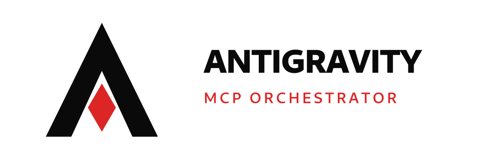

<div align="center">
  <picture>
    <source media="(prefers-color-scheme: dark)" srcset="branding/dist/logo-dark-lockup.png" />
    <source media="(prefers-color-scheme: light)" srcset="branding/dist/logo-lockup.png" />
    
  </picture>

  <h1>Antigravity MCP Orchestrator</h1>

  <p>
    <strong>Model Context Protocol (MCP) server connecting Google Gemini and local workflows to Google Antigravity IDE.</strong><br />
    Works on Linux, macOS, and Windows with zero external Python dependencies.
  </p>

  <p>
    <a href="https://pypi.org/project/antigravity-mcp/"></a>
    <a href="https://modelcontextprotocol.io"></a>
    <a href="https://python.org"></a>
    <a href="https://github.com/haydermuhib/gemini-antigravity-orchestrator-mcp"></a>
    <a href="LICENSE"></a>
  </p>

  <p>
    <a href="#quick-start">Quick Start</a> &bull;
    <a href="#overview">Overview</a> &bull;
    <a href="#connecting-to-google-gemini-connected-apps">Gemini Setup</a> &bull;
    <a href="#available-tools">Tools (18)</a> &bull;
    <a href="branding/dist/antigravity-mcp-brand-kit.zip">Brand Kit (ZIP)</a>
  </p>
</div>

---

## Overview

Google Gemini cloud services connect to external MCP servers over public HTTPS URLs. This server exposes an HTTP/SSE interface for Gemini while providing direct access to the local Antigravity IDE workspace, including:

- Discovery and inspection of 160+ skills across workspace, global, and plugin scopes.
- Inspection of plugins (`cursor-team-kit`, `pstack`, `ponytail`), rules (`GEMINI.md`, `AGENTS.md`), and transcripts.
- Command execution within the active workspace directory.
- Dynamic workspace switching at runtime (`set_active_workspace`) without server restarts.
- Zero external Python dependencies: implemented with Python's standard library.

---

## Quick Start

### 1. Install from PyPI (Recommended)

Install using `pip` or execute on-the-fly with `uvx` / `pipx`:

```bash
# Standard installation
pip install antigravity-mcp

# Or run instantly without pre-installing:
uvx antigravity-mcp --tunnel
```

### 2. Install from Source

Clone the repository and execute the setup script:

```bash
git clone https://github.com/haydermuhib/gemini-antigravity-orchestrator-mcp.git
cd gemini-antigravity-orchestrator-mcp
chmod +x install.sh && ./install.sh
```

The script verifies Python 3.10+, checks for `cloudflared`, installs the `antigravity-mcp` CLI into `~/.local/bin`, and registers the server with local Antigravity IDE configuration.

---

### Prerequisites

- **Python 3.10 or higher**
- **Cloudflared** (creates the HTTPS tunnel for Gemini Connected Apps)
  - **Linux**: `sudo apt install cloudflared` or download from [Cloudflare](https://developers.cloudflare.com/cloudflare-one/connections/connect-networks/get-started/create-local-tunnel/)
  - **macOS**: `brew install cloudflared`
  - **Windows**: `winget install Cloudflare.cloudflared`

---

## Running the Server

### Background Service (Linux and macOS)

```bash
# Start background server and tunnel
antigravity-mcp start   # or ./start_daemon.sh

# View status and retrieve the active public URL
antigravity-mcp status  # or ./status.sh

# Stop background server
antigravity-mcp stop    # or ./stop_daemon.sh
```

### Foreground Mode

Using Pixi:
```bash
pixi run tunnel
```

Using standard Python:
```bash
# Terminal 1: run server on port 8080
python3 server.py --http 8080

# Terminal 2: open tunnel
cloudflared tunnel --url http://127.0.0.1:8080
```

On Windows (Command Prompt or PowerShell):
```powershell
python server.py --tunnel
```

---

## Connecting to Google Gemini Connected Apps

1. Start the server using one of the methods above.
2. Run `./status.sh` or copy the HTTPS tunnel URL:
   ```text
   https://<subdomain>.trycloudflare.com/sse
   ```
3. In Google Gemini, navigate to **Settings** > **Connected Apps** > **Connect to an MCP server**.
4. Configure the connection fields:
   - **MCP server URL**: `https://<subdomain>.trycloudflare.com/sse`
   - **Client ID**: `gemini-client` (or any string)
   - **Client secret**: `gemini-secret` (or any string)
5. Click **Connect**. Gemini validates the endpoint and loads the tool catalog.

---

## Local Antigravity IDE Configuration (Stdio)

To run the server locally inside Antigravity IDE without HTTP or tunnels, add the following to `~/.gemini/config/mcp_config.json`:

```json
{
  "mcpServers": {
    "antigravity-orchestrator": {
      "command": "python3",
      "args": [
        "/path/to/gemini-antigravity-orchestrator-mcp/server.py",
        "--stdio"
      ],
      "env": {
        "PYTHONUNBUFFERED": "1"
      },
      "disabled": false
    }
  }
}
```

---

## Available Tools

The server provides 18 tools to connected models:

| Tool Name | Description | Key Arguments |
| :--- | :--- | :--- |
| `get_antigravity_status` | Returns IDE status, workspace path, tool/rule counts, and runtime info. | None |
| `list_known_workspaces` | Lists detected workspaces on the machine and shows which is active. | None |
| `set_active_workspace` | Switches the active workspace to another project directory at runtime. | `workspace_path` (required) |
| `list_skills` | Discovers skills across workspace, global, builtin, and plugin scopes. | `scope`, `plugin_filter` |
| `get_skill` | Retrieves `SKILL.md` text and metadata for a given skill. | `skill_name` (required) |
| `search_skills` | Searches skills using keyword matching. | `query` (required) |
| `list_plugins` | Lists installed plugins, manifests, versions, and subagents. | None |
| `get_plugin_details` | Returns full details of a plugin and its configuration. | `plugin_name` (required) |
| `list_rules` | Discovers active rules in workspace and global settings. | None |
| `get_rule` | Reads the content and trigger conditions of a rule. | `rule_identifier` (required) |
| `list_conversations` | Lists recent conversation IDs and brain artifacts. | None |
| `get_conversation_transcript` | Reads recent steps, user inputs, and tool calls from `transcript.jsonl`. | `conversation_id`, `limit` |
| `list_artifacts` | Lists markdown reports and diffs in the conversation brain. | `conversation_id` |
| `read_artifact` | Reads the markdown content of an artifact file. | `artifact_name_or_path` (required) |
| `execute_workspace_command` | Executes shell commands in the workspace with exit code, stdout, and stderr. | `command` (required), `cwd`, `timeout` |
| `create_workspace_skill` | Scaffolds a new Antigravity skill directory and `SKILL.md`. | `name`, `description`, `instructions`, `scope` |
| `create_workspace_rule` | Creates or updates an Antigravity rule in `.agents/rules/`. | `filename`, `content`, `scope`, `trigger` |
| `orchestrate_agent_workflow` | Generates an execution plan matching task intent with skills and rules. | `task` (required), `preferred_aesthetic` |

---

## Protocol Transports

1. **Server-Sent Events (SSE)**: `GET /sse` and `POST /message?sessionId=<id>`
2. **Streamable HTTP POST**: `POST /` and `POST /mcp`
3. **Stdio Protocol**: `python3 server.py --stdio`

---

## Testing

Run the automated test suites:

```bash
# HTTP, SSE, OAuth, HEAD pre-flight, and static asset tests
python3 test_http_mcp.py

# Stdio JSON-RPC 2.0 protocol and 18-tool verification
python3 test_mcp.py
```

---

## License

MIT License. See [LICENSE](LICENSE) for details.
